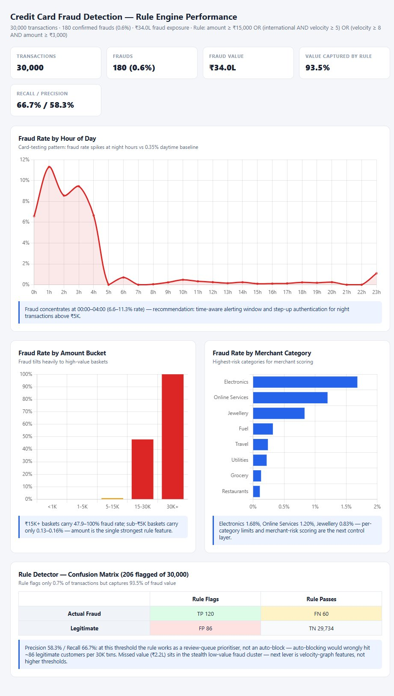

# 🕵️ Credit Card Fraud Detection (SQL · Rule Engine · Dashboard)

**Business question:** *Which transactions are most likely fraudulent, and what detection rule maximises fraud-value capture without drowning the review team?*

## ▸ Project Highlights

▸ Analysed **30,000 card transactions (180 confirmed frauds, 0.6%)** worth ₹34.0L of fraud exposure across hour, amount, merchant, region and card-velocity dimensions.

▸ Found fraud clusters at **night hours 00:00–04:00 with 6.6–11.3% fraud rate** vs 0.35% daytime baseline — a classic card-testing / teleboost pattern; enabled a time-aware alerting window.

▸ Built a **rule-based detector in pure SQL** (large amount OR international + high velocity OR velocity ≥ 8): flags 206 transactions, catches **120 of 180 frauds (66.7% recall) at 58.3% precision**, capturing **93.5% of total fraud value (₹31.8L of ₹34.0L)**.

▸ Showed the precision–recall trade-off: only 28% of flags are fraud, so the rule is positioned as a **review-queue prioritiser**, not an auto-block — blocking at this threshold would annoy ~86 legitimate customers per 30K transactions.

▸ Identified **Electronics (1.68%), Online Services (1.20%), Jewellery (0.83%)** as the highest-risk merchant categories — input to merchant-risk scoring and per-category limits.

## 📂 Structure

- `data/` — 30,000-row transaction dataset (CSV + SQLite `data.db`)
- `sql/queries.sql` — 6 analyses: hourly fraud rate, amount-tilt, merchant/card/region rates, velocity signal, confusion matrix, value capture
- `dashboard/` — interactive HTML dashboard (`index.html` + `agg_data.json`) + `screenshot.jpg`

## ▸ Key Insight

> Fraud is not spread evenly — it hides in **odd hours, high-value baskets and high-velocity cards**. A single SQL rule recovers 93.5% of fraud value while flagging only 0.7% of transactions.

## ▸ Tools

SQL (SQLite) · Rule-based classification · Precision/Recall analysis · Interactive dashboard (Chart.js)
